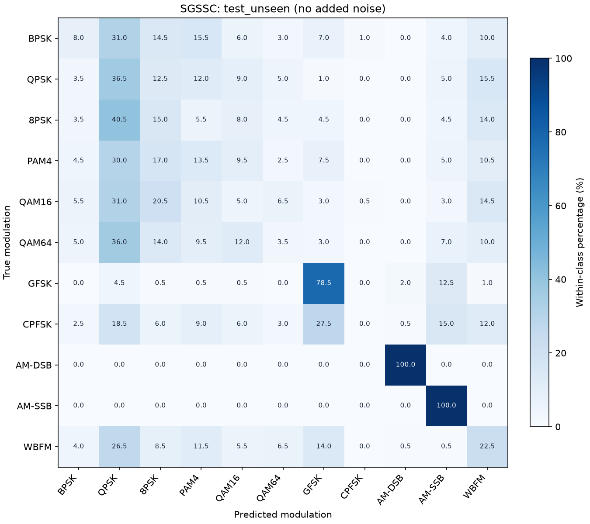
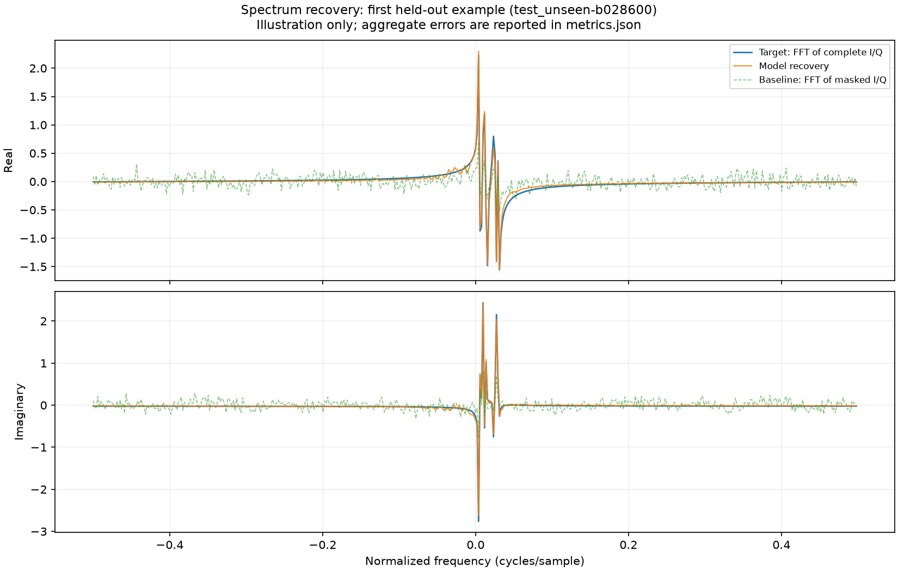
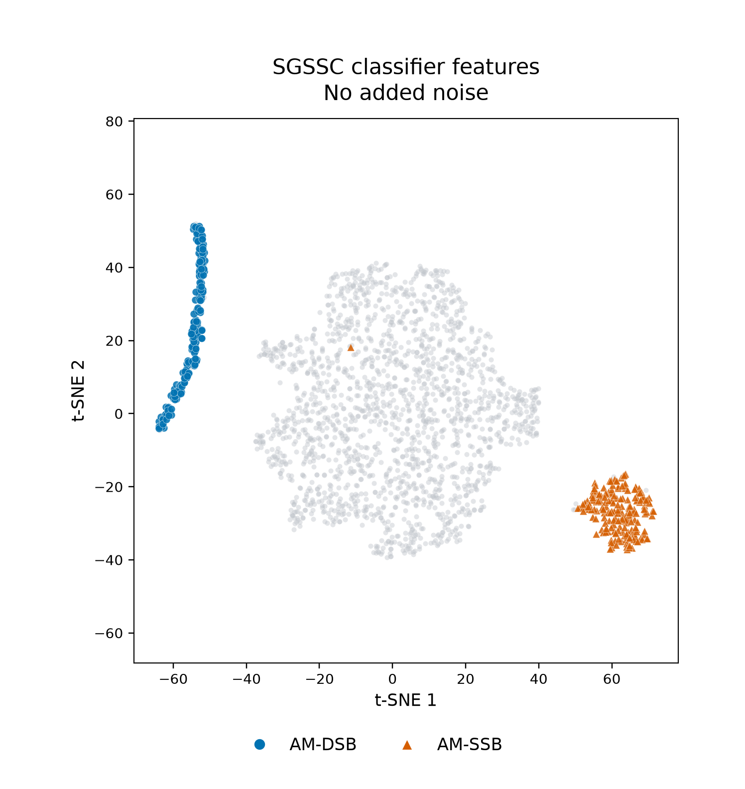

+# SGSSC for underwater acoustic signals

An independent implementation and underwater acoustic adaptation of **SGSSC**, using **no additional synthetic receiver noise** throughout pretraining, classifier training, evaluation, and feature visualization.

1. **Self-supervised pretraining:** recover the full complex spectrum from a masked I/Q window.
2. **Classifier training:** freeze the pretrained Transformer encoders and train its multilayer attention readout with a small labeled subset.
3. **Evaluation:** run modulation classification and masked spectrum reconstruction on the fixed Seen/Unseen test sets.
4. **Feature visualization:** L2-normalize the classifier's 128-dimensional attention features, reduce them to 50 dimensions with PCA, and apply two-dimensional t-SNE.

The spectrum prediction is not fed into the classifier. FFT constructs reconstruction targets and comparison baselines; the model predicts the spectrum from masked input.

**Only test data and trained weights are distributed.** Training code is included, but training and validation arrays are not. All evaluation commands use the supplied fixed weights.

Clone or download this repository. On its GitHub page, open **Releases → v0.1.0**, download **`assets.zip`**, and extract it into the repository root, alongside `pyproject.toml`. Merge the archive's `data/` and `weights/` directories with the existing folders. The source repository does not contain the binary test arrays or checkpoint. After extracting the assets, evaluation runs locally without authentication or further data downloads.

```text
sgssc-underwater-amc/
├── src/sgssc_amc/             # Models, clean training, evaluation and PCA50/t-SNE
├── scripts/                  # Clean training, reference plotting and optional export
├── data/
│   ├── classification/       # test_seen.npz, test_unseen.npz; metadata CSVs
│   └── spectrum/             # test_seen.npz, test_unseen.npz
├── weights/sgssc_inference.pt
├── provenance/data_manifest.json
├── reference_results/        # Checked release evaluation reports and figures
├── pyproject.toml
└── THIRD_PARTY_NOTICES.md
```


## Run classification and spectrum evaluation

```bash
python -m sgssc_amc classify --split all --output results/classification
python -m sgssc_amc spectrum --split all --output results/spectrum
```

Both commands use batches of 64 by default. They evaluate both 2,200-window splits and write metrics and plots to the selected output directory. Data and checkpoint locations can be supplied explicitly:

```bash
python -m sgssc_amc classify --split all --data-dir data --checkpoint weights/sgssc_inference.pt --output results/classification
python -m sgssc_amc spectrum --split all --data-dir data --checkpoint weights/sgssc_inference.pt --output results/spectrum
```

Use `--batch-size` and `--threads` to control execution, or `--no-plots` to write numeric results only. Each output root contains `report.json`, including evaluation options and checkpoint/data hashes. Each split has `metrics.json` and `predictions.npz`; plots are `confusion_matrix.png` for classification and `spectrum_example.png` for reconstruction. The spectrum example is the first sample in the split, not a sample selected for visual quality.

The checkpoint contains the encoder, classification readout, and spectrum head as tensors with basic metadata. The loader uses `torch.load(..., map_location="cpu", weights_only=True)`; optimizer and random-generator states are excluded.

## Included data

| Property | Definition |
|---|---|
| Input | Float32 I/Q, `[N, 512, 2]`; 8 kHz; 64 ms per window |
| Classes | BPSK, QPSK, 8PSK, PAM4, QAM16, QAM64, GFSK, CPFSK, AM-DSB, AM-SSB, WBFM |
| Classification splits | `test_seen`: 2,200 windows; `test_unseen`: 2,200 windows; 200 per class |
| Spectrum splits | The same 2,200 + 2,200 held-out windows and base IDs |
| Spectrum masking | Fixed seed `20261117`; exactly 358 of 512 time points masked per window; I and Q masked together |
| Spectrum target | `fftshift(fft(I + 1j*Q, norm="ortho"))`, saved as real/imaginary components |
| Noise condition | No additional synthetic noise; measured-channel effects remain |
| Scale | Source-project training-derived common scale `3.0439862190625893`; already applied, with no test-set refitting |

`provenance/` records export identity and source information. Keep it alongside `data/` and `weights/` when moving the package. The original multi-gigabyte channel archive and unrelated research experiments are not included.

NPZ arrays can be read with `numpy.load(path, allow_pickle=False)`:

| File | Fields |
|---|---|
| `data/classification/test_seen.npz`, `test_unseen.npz` | `iq`: float32 `[N,512,2]`; `labels`: int64 `[N]`; `base_ids`: Unicode `[N]` |
| `data/spectrum/test_seen.npz`, `test_unseen.npz` | `masked_iq`, `target_spectrum`: float32 `[N,512,2]`; `masked_positions`: bool `[N,512]` (`True` means masked); `base_ids`: Unicode `[N]` |

The accompanying classification metadata CSVs preserve source locations. `provenance/data_manifest.json` records hashes, scale, masking, source attribution, and split-isolation checks.

## Model and training provenance

The encoder has eight Transformer layers, width 128, eight attention heads, and FFN width 1,024. Each token covers 16 consecutive complex samples, producing 32 tokens. The classifier concatenates outputs from all eight layers along the token axis, applies sigmoid attention weights, sums the weighted features, and predicts 11 classes.

This package uses the project's **flatten-to-linear spectrum head**: the final `[32,128]` feature map is flattened to 4,096 values and linearly mapped to 1,024 values (512 complex frequency bins).

| Stage | Historical run used for this release |
|---|---|
| Self-supervised pretraining | 242,000 training windows; 20,000 batch updates; batch 64; Adam `1e-4`; 70% masking; no additional noise |
| Pretraining selection | Minimum MSE on 512 fixed validation windows; selected update 20,000 |
| Classification training | Frozen encoder; 1,210 labeled windows (0.5% of 242,000); 2,000 updates; batch 64; Adam `1e-3`; ordinary cross-entropy |
| Classification selection | Highest accuracy on 2,200 separate validation labels; earliest tie; selected update 1,000 |
| Random seed | `20261001`, label selection run 0 |

These are **batch updates, not epochs**. Validation labels are additional to the 1,210 training labels. The 512-sample input, joint I/Q patching, linear spectrum head, and optimization budgets are documented project adaptations.

## Classification reference results

Historical full-test results for the supplied classification model:

| Split | Correct / total | Accuracy | Macro-F1 |
|---|---:|---:|---:|
| Seen record | 788 / 2,200 | 35.82% | 32.95% |
| Unseen record | 765 / 2,200 | 34.77% | 30.39% |

These results describe the specified single-seed, no-additional-noise protocol. Model weights were selected using validation data; these test results were not used to select a checkpoint.

The standalone release reproduces every historical classification prediction on both splits. Floating-point logits differ by at most `6.68e-6` from the saved historical calculation; predicted classes and aggregate metrics are unchanged.



## Spectrum reference results

Spectrum evaluation for this release uses newly fixed masks on the retained test windows. These are new held-out reconstruction results, separate from historical pretraining validation MSE and classification accuracy.

| Split | Model MSE | Model NMSE | Non-DC NMSE | Masked-input FFT NMSE |
|---|---:|---:|---:|---:|
| Seen record | 0.000748817 | 0.0229438 | 0.0233543 | 0.6998204 |
| Unseen record | 0.000964810 | 0.0265751 | 0.0279916 | 0.6992854 |

Lower is better. MSE averages over samples, frequency bins, and real/imaginary coordinates. NMSE is the global squared-error sum divided by global target energy; it is not a mean of per-window ratios. The zero predictor has NMSE 1.0. The masked-input FFT baseline directly transforms the zero-filled masked signal, without learned recovery. Non-DC results exclude the single shifted zero-frequency bin. Good spectral reconstruction alone does not imply accurate modulation classification.

The following plot always uses the first saved Unseen example, not a sample chosen for reconstruction quality:



Checked release summaries and plots are retained in `reference_results/classification/` and `reference_results/spectrum/`. Full spectrum prediction arrays are regenerated by the evaluation command and omitted from the distribution archives to avoid duplicate binary output. The [verification record](provenance/release_validation.json) documents the checks and environment: Python 3.12.14, CPU PyTorch 2.14.0, and NumPy 2.5.3 on Windows. The extracted and original model implementations produced bitwise-equal outputs on 16 fixed examples from each split for both tasks; all 4,400 classification predictions match the historical results, and spectrum errors were independently recomputed from saved outputs. These are the verification versions, not a platform-specific wheel lock.

## Visualize classifier features

The reference plot contains only the **no-added-noise Unseen test condition**, with all 2,200 windows retained. AM-DSB is blue, AM-SSB is orange, and the other nine classes are gray. The legend names only the two AM classes. The figure has no gray text.



To redraw this exact reference figure from its saved coordinates, without refitting:

```bash
python scripts/plot_reference_features.py --output results/reference_features
```

To extract features from the supplied checkpoint and fit a new projection:

```bash
python -m pip install -e ".[visualize]"
python -m sgssc_amc visualize --split test_unseen --output results/features
```

```text
Complete I/Q -> frozen encoder -> trained attention pooling -> 128-D features
                                                            |-> Linear(128, 11) -> prediction
                                                            |-> L2 -> PCA50 -> t-SNE -> plot
```

This follows the SGSSC panel of the project's LLDNet manuscript Figure 8: row L2 normalization, 50-component PCA with full SVD and no whitening, then t-SNE. The t-SNE settings are two dimensions, perplexity 30, early exaggeration 12, automatic learning rate, 1,500 iterations, Euclidean distance, Barnes-Hut with angle 0.5, PCA initialization, and random seed `20261031`. The visualization extra pins scikit-learn `1.7.2`, matching the archived projection.

The default is the complete `test_unseen` split. `--split test_seen` is also available and uses only that no-added-noise split in a separate fit.

A new extraction writes `report.json` plus a split subdirectory containing `features.npz`, `pca.npz`, `coordinates.csv`, `feature_tsne.png`, and `feature_tsne.svg`. The repository stores only the historical reference coordinates, figures, and provenance; generated full feature arrays remain local. The reference coordinates are identical to the archived clean SGSSC panel. A fresh extraction/refit can differ numerically with library versions and floating-point computation; use the redraw command when reproducing the exact published picture.

## Train on separately supplied clean data

Training entry points preserve the two stages described above. They use the trainable model modules directly, while the frozen inference wrapper remains evaluation-only.

```bash
# Masked-spectrum pretraining; defaults: 20,000 updates, batch 64, Adam 1e-4.
python scripts/train_clean.py pretrain --train-data training_data/pretrain_train --val-data training_data/val --output training_runs/pretrain

# Attention readout and final classifier; encoder frozen.
# Defaults: 2,000 updates, batch 64, Adam 1e-3; 1,210 preselected training labels.
python scripts/train_clean.py classifier --train-data training_data/labeled_train --val-data training_data/val --pretrained training_runs/pretrain/best.pt --output training_runs/classifier
```

To train a new classifier from the supplied pretrained encoder, pass `--pretrained weights/sgssc_inference.pt` instead. The classifier's readout is initialized anew. Training selects checkpoints on validation data only.

Data format, split checks, and optional parameters are described in [TRAINING.md](TRAINING.md) and `python scripts/train_clean.py --help`. The published weights remain the original historical weights. The newly packaged training routines were checked with small synthetic examples.

## Source and verification

The evaluation entry point is `python -m sgssc_amc`. Optional `scripts/export_test_data.py` and `scripts/export_weights.py` read the original research archive to regenerate the **clean** release assets.

```bash
python -m pip install -e ".[test,visualize]"
python -m pytest
```

[Evaluation verification](provenance/release_validation.json), [feature verification](provenance/feature_validation.json), and [training-code provenance](provenance/training_code.json) record the checks. The repository includes no training/validation waveforms.
## Sources and license status

- Method: [Predicting Spectral Information for Self-Supervised Signal Classification, IJCAI 2025](https://www.ijcai.org/proceedings/2025/0752.pdf).
- Measured channels: [Underwater Acoustic Channel Repository, v1.0](https://doi.org/10.5281/zenodo.21287414), Pink subset, **CC BY 4.0**. Full author attribution and the derivation statement are in [THIRD_PARTY_NOTICES.md](THIRD_PARTY_NOTICES.md).
- Replay software used upstream: [UWA Channels Python](https://github.com/uwa-channels/python), v0.7.1, MIT.
